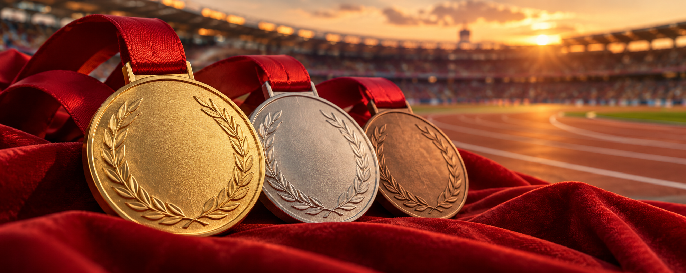

# 🏅 2008 Olympic Medalists: Tidy Data Project

  

## Project Overview

In this project I clean the 2008 Olympic medalists data, and use pivot tables and heatmaps to compare the records. I use the approach that is guided by the principles of tidy data, where each variable is a column, each observation is a row, and each type of observational unit is a table.

## Dataset

The data set provides the names, gender, sport and medal categories of the medal winners of the Olympics 2008. Original headings combine gender and sport, e.g., `male_archery`. `pd.melt()` was used and empty medal entries were dropped and gender and sport split into separate columns. I also changed hyphens in sport names to spaces. The tidy table has 1,875 rows and four columns: `Medalist_Name`, `Gender`, `Sport` and `Medal`.

## How to Run

1. Open the `TidyData-Project` folder in VS Code editor. Make sure the CSV and notebook are in the same folder.
2. Install pandas, seaborn, matplotlib and a notebook kernel:
3. Open `olympics_tidy_data.ipynb`, select your Python kernel and click **Run All**. Below the code cells the pivot tables and two heatmaps will be presented.

## Visual Examples

### Records by Sport and Gender

There are 81 female records in athletics and 63 in swimming. Swimming is pretty much tied: 63 female records to 62 male records. Rowing has a bigger gap.

### Records by Medal Category

The most records belong to bronze for both groups, 294 female and 374 male. These are medalist records so a team medal can count multiple times.

## References

- [OlympicsGoNUTS: 2008 data](https://edjnet.github.io/OlympicsGoNUTS/2008/)
- [Pandas Cheat Sheet](https://pandas.pydata.org/Pandas_Cheat_Sheet.pdf)
- [Hadley Wickham: Tidy Data](https://vita.had.co.nz/papers/tidy-data.pdf)
